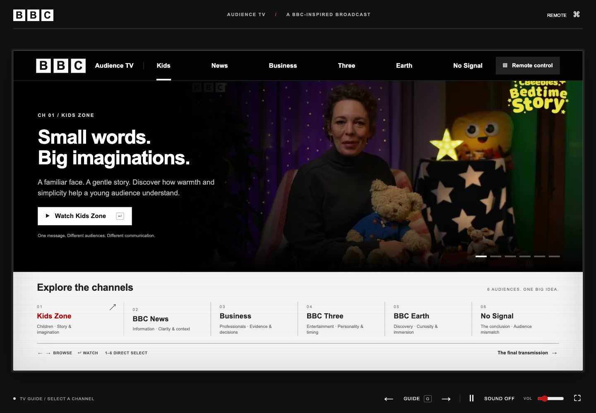
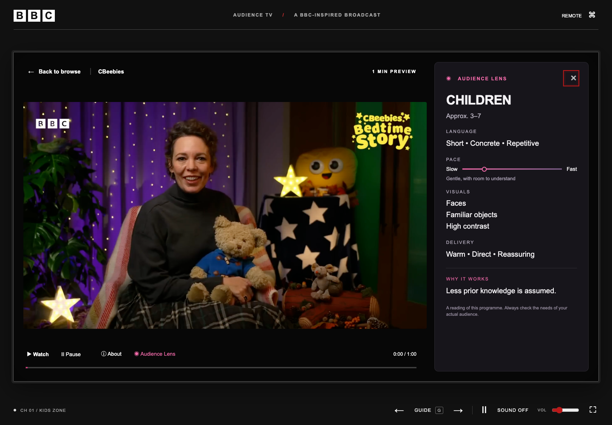

# Audience TV

An interactive browser presentation that uses a television interface to explore how communication changes for different audiences.

**Status:** Private source archive authorized by Jeremy Budianto. This repository contains the interface code, five programme posters, and review screenshots. The original broadcast videos remain local because of their size and unresolved redistribution rights. Public release has not been cleared.



## Overview

Audience TV turns an audience-analysis lesson into six selectable channels: children, news, business, entertainment, nature documentary, and an audience-mismatch example. A programme guide leads into video previews. An optional Audience Lens opens beside the footage to explain language, pace, visual choices, and delivery.

This is a static HTML, CSS, and JavaScript experience designed around local media. The archived interface can be reviewed without the omitted videos, but previews and full-programme playback require privately supplied, rights-cleared local files. It does not connect to a television service or stream live broadcasts. It has no server application, login system, database, or remote API.

## Features

- Programme guide with keyboard selection, direct channel shortcuts, and a remote-control panel.
- Five local video previews, with replay, mute, volume, pause, and full-programme controls.
- On-demand full-video loading with cancellation when the viewer navigates away.
- Audience Lens that resizes the footage and shows educational interpretation beside it.
- A sixth channel demonstrating an audience mismatch and a concluding presentation sequence.
- Animated transitions with a queued latest destination when navigation happens rapidly.
- Reduced-motion handling, keyboard controls, status announcements, and hidden-tab playback pausing.
- Canvas-generated television noise and Web Audio interface sounds.

The interface scales a 1440 × 810 stage to the available space. It is best suited to a desktop display or presentation screen; scaling alone does not establish a comfortable mobile reading experience.

## Screenshots



Screenshots were captured from the complete local application on October 29, 2026, before the videos were excluded from this private archive. They include third-party footage and branding. Public use has not been cleared; these screenshots do not demonstrate video availability in this archive.

## Technology stack

| Layer | Technology |
| --- | --- |
| Application | HTML, CSS, plain JavaScript |
| Rendering and interaction | DOM events, requestAnimationFrame, Web Animations API |
| Video | HTMLVideoElement, local MP4 files and JPEG posters |
| Visual effects | Canvas 2D |
| Interface audio | Web Audio API |
| Layout | CSS plus ResizeObserver stage scaling |

No package installation, build step, framework, or CDN is required by the reviewed application. No external web requests occurred during the local browser checks.

## Architecture

```text
index.html          Application shell, controls, lens, remote, and opening screen
style.css           Presentation layout, channel styles, motion, and player states
script.js           State, channel data, rendering, video management, and controls
assets/images/      Programme posters derived from source footage
assets/video/       Local-only playback files; omitted from the repository
```

`script.js` contains the main application in one file. State variables track the current mode, channel, playback, overlays, and navigation. `VideoDeck` manages preview/full-video elements, shared sound settings, loading, replay, and pause behavior. A transition owner queues a new destination while animations are running. The animation loop advances timed presentation beats and player progress. Channel descriptions and educational notes are embedded in the code.

## Run locally

Open `index.html` in a modern browser, keeping `script.js`, `style.css`, and `assets/images/` beside it. The programme guide, posters, remote controls, audience-analysis text, and presentation interface can be reviewed. Video previews and full programmes are **not included** and will show the media-unavailable/retry state until local playback files are supplied.

Alternatively, serve the project folder:

```sh
python3 -m http.server 8000 --bind 127.0.0.1
```

Open `http://127.0.0.1:8000`. To restore playback privately, supply rights-cleared local videos under the expected names in `assets/video/`, listed in [the media manifest](docs/MEDIA-MANIFEST.md). No download source or permission to redistribute the original broadcasts is provided. Keep these files out of Git.

The screenshots and playback verification below describe the original complete local project. The private source archive deliberately omits its ten video files.

## Controls

| Input | Action |
| --- | --- |
| Left / Right arrows | Browse or switch channels |
| 1–6 | Tune directly |
| Enter | Select, open full programme, or advance a presentation beat |
| Space | Pause / resume |
| G | Return to guide |
| I | Toggle Audience Lens |
| Escape | Close lens, then return to guide |
| M / F | Mute / fullscreen |

## My contribution and AI-assisted development

Jeremy Budianto conceived and directed the desired experience, studied other websites for inspiration, and used Codex to generate and revise the implementation. His contribution is the project idea, visual and functional direction, and decisions about what should be built, following his account of his development process.

Codex assisted with the implementation. This portfolio does not claim that Jeremy hand-coded the architecture or independently authored each file. It makes no claim of ownership over the source programmes, presenters, footage, music, or broadcaster marks. The checks below were performed during portfolio preparation, not attributed to Jeremy's original development work.

## Verification

Checks performed on October 29, 2026:

- JavaScript syntax check passed.
- All six programme-guide choices rendered; arrow-key selection changed the selected channel.
- A local preview loaded at 1280 × 720, muted by default.
- Audience Lens opened and Space paused the video.
- Full-programme playback loaded and displayed the full-video state.
- Returning to the guide left no videos playing in the document.
- No JavaScript page errors or external web requests were observed.
- A 390 × 844 viewport showed no horizontal page overflow; mobile usability was not fully audited.

These were focused checks, not a complete browser, accessibility, or media-quality audit.

## Media, credits, and publication recommendation

The original project README and local development manifests identify footage from CBeebies, BBC News, CNBC, BBC Three's *Mandy*, and BBC Earth's *Blue Planet II*. The original local bundle includes encoded audio. Five posters derived from those programmes remain in this private review archive, along with screenshots and the BBC/iPlayer-style identifiers embedded in the unchanged source code.

**Repository visibility: private.** Jeremy authorized the source archive. The ten original MP4 files remain local: together they are approximately 459 MB (438 MiB), and `earth-full.mp4` alone is approximately 198 MB. No video hosting or Git LFS transfer is configured. See [the media manifest](docs/MEDIA-MANIFEST.md) for omitted files and documented provenance.

No redistribution license or permission record was found in the reviewed project documents. Public release remains pending replacement of the footage, posters, broadcaster marks, and related screenshots with owned or appropriately licensed material. A media ignore rule prevents new video files from being added automatically; it does not remove media already tracked by Git or replace branding embedded in the code. No open-source license is asserted for the mixed-rights project.
